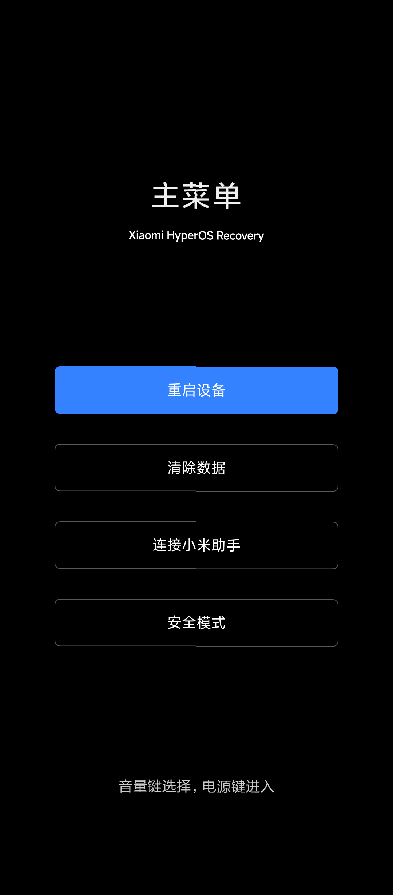

# xaga emulator (MT6895)

**A full-system, scriptable simulator for the Xiaomi xaga (Redmi Note 11T Pro / POCO X4 GT, MediaTek MT6895).**

Goal: boot the *real* device firmware stack — preloader -> BL2_EXT -> ATF -> TEE -> GZ -> LK -> Linux -> Android —
and faithfully emulate the hardware around it, so that recovery, fastboot, adb and the Android UI run
against the emulated phone instead of a model of it.

This project is implemented as a QEMU machine model (`-M mt6895`) on top of
[QEMU](https://www.qemu.org/) (fork at branch `xaga`, based on `v11.1.1`). **QEMU is the substrate;
the emulator is the project.**

A hard rule shapes everything below: the model never patches guest images or plants guest state to get
past a check. Missing hardware behaviour is modelled as hardware behaviour; workarounds are allowed only
as clearly named, default-off diagnostics.



## What already works

| Area | State |
|---|---|
| BROM stub, preloader, BL2_EXT, ATF (TF-A v2.4) — real images, no image patching | ✅ native stage tracking (`MTK_SIP_KERNEL_BOOT` clears `0x4825abd8`), BL33 and Linux kernel `0xc2000xxx` MTK SiP SMCs dispatch cleanly through BL31 |
| TEE (Soter450 / ISEE450, plaintext BL32) + GICv3 per-group HPPI (`arm_gicv3`) | ✅ calibrates timer, verifies TAs, backs KeyMint / `keystore2`; `hppi_grp[3]` prevents disabled `G1NS` interrupts from starving Secure PPI 29 |
| GZ (GenieZone hypervisor, EL2) + EMI MPU / MIU (`mtk_syscon`) | ✅ `gz_a`/`gz_b` decrypted in-guest via DXCC AES; MIU end-flag readback and AID selector commit produce `30` regions and `17` hypervisor unmaps matching hardware (keeping `scp_share` mapped) |
| LK -> Linux 5.10 -> Android userspace (`SystemServer`) | ✅ 7 dynamic partitions mounted, `second_stage_init`, `172` kernel modules (`vendor.all.modules.ready=1`), `keystore2` / `keymint`, `vold` `make_f2fs` `/data` mount, `zygote`, `SurfaceFlinger` / `hwcomposer`, and `SystemServer` (`AMS` / `PMS` / `WMS` / `IMS`) with 0 kernel panics / 0 WDT resets |
| ARM DSU PMU cluster system registers (`mt6895`) | ✅ `S3_0_C15_C5_0..7` and `S3_0_C15_C6_0..5` allow `arm_dsu_pmu.ko` online init with zero `do_undefinstr` panics |
| DebugTop DEM/tracer & CONSYS WF/BGF windows (`mt6895`) | ✅ 14 mapped MMIO regions (`0x0d01a000..0x0d100000`, `0x184*`/`0x185*`/`0x188*`/`0x189*`) let connectivity modules (`conninfra`/`bt_drv`/`fmradio_drv`/`gps_drv`/`wlan_drv`) load cleanly without external aborts |
| GPUEB mailbox & gpufreq IPI (`mtk_gpueb`) | ✅ dedicated SysBus device with RV33 boot handshake, 160-slot raw-payload `mbox0` SRAM, GIC SPI `516`, and `IPI_ID_GPUFREQ` OPP/shared-status replies (`gpufreq_wrapper`, `mtk_gpufreq_mt6895`, `/proc/ged`, `gralloc4` operational) |
| 8-core SMP bring-up (`MPIDR.MT`, `psci-conduit=disabled`, CPC power-state ordering) | ✅ `8 CPUs` online and activated on the default normal-boot path |
| Tinysys SCMI v2 mailbox (`mtk_tinysys_mbox`) | ✅ DEN0056 Base (`0x10`) + vendor (`0x80`) protocols with in-place A2P replies (`SSPM platform service is ready`, `qos_ipi_init ready!`, `sspm_v3` clean init) |
| ADSP subsystem (`mtk_adsp`) + AP<->ADSP 4-channel mailbox | ✅ CFG/CFG2 control windows, MBOX0..3 (GIC SPI `644..647`), per-core DTCM; dual-core `adsp_system_bootup done`, suspend/resume, MPU sharedram, audio probes (`mt6895-mt6368`, `mt6895-audio`, `mt6368-sound`, `snd_scp_ultra`, `mtk_dsp_probe`) |
| Recovery mode (`MTK_BOOT_MODE=2`) + Xiaomi recovery UI (full screen, no blit artifacts) | ✅ |
| Touchscreen: MTK SPI controller + Novatek NVT36672C | ✅ driver binds as `input2`, real coordinates through EINT -> GIC; in-guest `getevent` sees DOWN/UP |
| USB device mode: mtu3-style MAC/QMU UDC, native Type-C/TCPC chain (MT6375 -> BC1.2 -> extcon -> role switch) | ✅ enumeration, `A_CNXN`, `shell_v2`, `getevent` in Recovery — **no `MTK_USB_GADGET`** |
| `sideload-host` (Apply update from ADB) | 🚧 enumerates and answers `sideload-host:...`, but `adbd` still owns FunctionFS (`verifiedbootstate=green`) |
| Display: OVL composition, dual-pipe half swap, MIPI DSI command queue, GCE/CMDQ execution, SimpleFB fallback | ✅ Recovery UI verified end-to-end; normal-boot now renders Android second-screen `BootAnimation` frames through `SurfaceFlinger` -> `hwcomposer` -> `mediatek-drm` / `CMDQ` / `M4U IOMMU` (34-bit IOVA) -> dual-pipe `OVL` scanout (using software Vulkan/ANGLE while virtual Mali-G610 / host GPU acceleration is on the roadmap) |
| Storage: UFS host controller (UIC/UTP/UCD), 4 KiB LUs, GPT, RPMB, block-backend (raw/snapshot/CoW) | ✅ |
| USB host: xHCI with keyboard / network / audio enumeration | ✅ |
| USB device + host-side fastboot client (`getvar`, `download`, `flash`) | ✅ |
| PMIC/SPMI: MT6363 / MT6368 / MT6319, SPMI-PMIF, regulators, VSEL monitor aliases | ✅ all 15 main rails match the unit's own boot log |
| MT6375 sub-PMIC: TCPC/BC1.2, ADC, IRQ; I²C APDMA; EINT level-latched IRQs | ✅ |
| GPIO/pinctrl (`mtk_syscon`): MT6895 controller banks (DIR / DOUT / MODE SET / CLR / MWR) | ✅ `scp.ko` `v_req` mux check passes |
| Crypto engines: DXCC-SEC (AES-128-CTR, SHA-256) and MASP/HACC | ✅ execute the guest's descriptors |
| Secure address alias (`0x800000000 + PA`) for TEE/GZ, topckgen ULPOSC control, KPD, RTC | ✅ |
| Audio (`mtk_afe`) + DSP/codec probe path | 🧪 controller/DSP probes succeed; end-to-end audio playback still to be validated |

## Where the zero-injection boot stands

With **zero `MTK_*` overrides**, the unmodified firmware ladder runs on `-smp 8`:

```text
BROM -> preloader -> BL2_EXT -> ATF -> TEE (Soter450) -> GZ (EL2) -> LK -> Linux 5.10.269
     -> init (1st stage) -> 7 dynamic partitions mounted -> init (2nd stage)
     -> servicemanager / vold / keystore2 / keymint -> make_f2fs /data & mount_all --late
     -> 172 kernel modules (vendor.all.modules.ready=1) -> zygote / SurfaceFlinger / hwcomposer
     -> BootAnimation (dual-pipe OVL) -> SystemServer (AMS/PMS/WMS/IMS)
```

- **Boot, hypervisor, and SMP**: ATF hands off natively via `MTK_SIP_KERNEL_BOOT`, GenieZone unmaps the exact 17 protected regions (keeping `scp_share` at `0x8f000000` mapped), all 8 cores come online, and ARM DSU PMU system registers (`S3_0_C15_C5_0..7`, `S3_0_C15_C6_0..5`) eliminate `arm_dsu_pmu.ko` `do_undefinstr` panics.
- **TEE & storage encryption**: GICv3 per-group HPPI unblocks Soter450 TEE timer calibration (`PPI 29`), allowing `keystore2` / `vendor.keymint-beanpod` to generate keys and `vold` to format `/dev/block/by-name/userdata` with `make_f2fs`.
- **Subsystems & modules**: Tinysys SCMI v2 brings up `SSPM`, `mtk_syscon` GPIO MWR passes `scp.ko` mux checks, `mtk-adsp` + native ATF Kernel SiP dispatch bring both ADSP cores and audio probes up cleanly, `DebugTop`/`CONSYS` MMIO windows let connectivity drivers (`conninfra`, `bt_drv`, `fmradio_drv`, `gps_drv`, `wlan_drv`) load without external aborts, and `mtk-gpueb` satisfies `gpufreq_wrapper` / `mtk_gpufreq_mt6895` / `/proc/ged` / `gralloc4` initialization — reaching `vendor.all.modules.ready=1` across all 172 modules with zero panics and zero watchdog resets.
- **Display & current frontier**: Under isolated software Vulkan/ANGLE rendering on userspace `vendor_a`/`odm_a`, `SurfaceFlinger` -> `hwcomposer` -> `mediatek-drm` / `CMDQ` / `M4U IOMMU` (34-bit IOVA) -> dual-pipe `OVL` scans out real Android `BootAnimation` frames while `SystemServer` completes `ActivityManagerService`, `PackageManagerService`, `WindowManagerService`, and `InputManagerService` startup. Next milestones are full SetupWizard / Launcher desktop completion, fixing remaining hardware-backed HAL issues (such as thermal/backlight/sensors), and implementing virtual Mali-G610 / host GPU acceleration plus MTTCG multi-core performance optimization.

## Roadmap

- [x] Boot chain, display, UFS, USB, recovery UI
- [x] LK fastboot over emulated USB device mode (host-side client included)
- [x] LineageOS kernel boot to recovery (power/clock/bus-protection modelling)
- [x] Real GZ decryption: DXCC-SEC AES engine executes the preloader's descriptors
- [x] Touchscreen end to end (driver bind, EINT, GIC, real coordinates)
- [x] PMIC rails matching the unit, OTP/efuse windows, ULPOSC control
- [x] 8-core SMP on the default (zero-injection) normal-boot path
- [x] Native USB/ADB in Recovery: enumeration, `A_CNXN`, `shell_v2`, in-guest `getevent`
- [x] MT6375 TCPC/BC1.2 + I²C APDMA + EINT level IRQ; USB QMU stop/restart
- [x] MT6895 GPIO controller semantics (SET/CLR/MODE masked write)
- [x] EMI MPU / MIU selector commit + last-slot readback (`scp_share` mapped cleanly)
- [x] GICv3 per-group HPPI tracking -> Soter450 TEE / KeyMint / `/data` f2fs mount
- [x] Tinysys SCMI v2 mailbox (`mtk_tinysys_mbox`) + `sspm_v3` clean init
- [x] ADSP subsystem + 4-channel mailbox (`mtk_adsp`) + native ATF Kernel SiP SMC dispatch
- [x] ARM DSU PMU cluster system registers & DebugTop/CONSYS connectivity MMIO windows (zero-panic 172-module boot)
- [x] `mtk-gpueb` mailbox & `IPI_ID_GPUFREQ` responder (`/proc/ged` & `gralloc4`)
- [x] Android second-screen bring-up (`SurfaceFlinger` + `BootAnimation` via `mediatek-drm` / `CMDQ` / `M4U IOMMU` / dual-pipe `OVL`)
- [ ] Android SetupWizard / Launcher desktop completion and remaining HAL hardware fixes (e.g. thermal/backlight/sensors)
- [ ] Virtual Mali-G610 / host GPU acceleration & MTTCG multi-core performance
- [ ] `700 MHz` ULPOSC calibration meter
- [ ] `sideload-host` end to end (unlock chain / `minadbd` taking FunctionFS)
- [ ] Full LineageOS/Android boot without any diagnostic env
- [ ] Audio path end-to-end (AFE + MT6368 codec + ADSP audio tasks)
- [ ] Networking (Wi-Fi/BT connectivity stack), sensors, camera
- [ ] Deterministic record/replay and regression suites for every subsystem

## Building

Requirements: QEMU build dependencies (meson, ninja, glib, pixman, ...) on Linux, macOS or MSYS2.

```bash
git clone --depth 1 -b xaga https://github.com/Cyber-Mobile/xaga-qemu.git xaga-qemu
cd xaga-qemu
scripts/build.sh            # configures build/ and builds qemu-system-aarch64
```

## Running

The emulator boots **your own device dumps** (none are distributed here):

- `fw/LUA_1` — preloader image
- `fw/gpt_512.bin` — GPT blob used by the BootROM stub
- `data/lu2.img` — raw UFS user-data LUN (sparse raw image recommended)

Zero-injection normal boot, 8 cores, deterministic timing (the path used for bring-up):

```bash
./build/qemu-system-aarch64 \
  -M mt6895,preloader=fw/LUA_1,gpt=fw/gpt_512.bin,data=data/lu2.img,entry-bytes=3072 \
  -m 6G -smp 8 -display none -monitor none \
  -icount shift=4,sleep=off -accel tcg,tb-size=4096 \
  -serial file:OUT.log
```

Recovery, with the touch panel and USB device mode enabled:

```bash
MTK_BOOT_MODE=2 MTK_TOUCH=1 MTK_USBDEV=1 \
./build/qemu-system-aarch64 \
  -M mt6895,preloader=fw/LUA_1,gpt=fw/gpt_512.bin,data=data/lu2.img,entry-bytes=3072 \
  -m 6G -smp 8 -display none -monitor none \
  -icount shift=4,sleep=off -accel tcg,tb-size=4096 \
  -serial file:OUT.log
```

The kernel's console is muted once it takes over; the model can periodically scan the kernel log ring for
markers with `MTK_KMEM_SCAN` / `MTK_KMEM_MS` (see below).

### Environment switches

Platform & test configuration:

| Variable | Effect |
|---|---|
| `MTK_BOOT_MODE=2` | boot recovery |
| `MTK_LU2_SNAP=1` | user-data LUN snapshot mode (writes stay in a scratch overlay) |
| `MTK_LU2_RO=1` | user-data LUN read-only |
| `MTK_TOUCH=1` | instantiate the MTK SPI controller and the Novatek NVT36672C touch client |
| `MTK_USBDEV=1` | device-mode UDC (mtu3-style) for fastboot/adb |
| `MTK_USBDEV_TCP=4444` | bridge that UDC to a TCP chardev (host client connects to `127.0.0.1:4444`) |
| `MTK_USB_HOSTMODE=1` | expose mtu3 as an xHCI host with emulated devices |
| `MTK_KMEM_SCAN`, `MTK_KMEM_MS` | scan guest RAM for configured markers at the given host-time windows |

Observation only (none change guest-visible behaviour):

| Variable | Effect |
|---|---|
| `MTK_FBDUMP=<prefix>`, `MTK_FBDUMP_MS` | dump composed frames as PPM |
| `MTK_DISP_SRC` (`simplefb` or `drm`) | select the display path |
| `MTK_GCE_EXEC=on` | execute GCE/CMDQ instructions |
| `MTK_DXCCLOG=1`, `MTK_DXCC_AESLOG=1`, `MTK_GZ_DUMP=<prefix>` | DXCC-SEC register/descriptor trace and buffer dumps |
| `MTK_IOMMU_LOG=1` | M4U page-table bases, TLB invalidations and translations |
| `MTK_SYSCON_TRACE=1`, `MTK_PINCTRL_RD=1` | syscon / pinctrl access traces |
| `MTK_ADSP_LOG=1` | log `mtk-adsp` CFG/CFG2/MBOX transitions and core start events |
| `MTK_GPUEB_DBG=1` | log `mtk-gpueb` boot handshake, `mbox0` IPI commands and `gpufreq` responses |
| `MTK_SCMILOG=1` | log Tinysys SCMI v2 request/reply exchanges |
| `MTK_S2IPA=1` | print full IPA, fault level, PC and EL on stage-2 data aborts |
| `MTK_INIT_LOG=1`, `MTK_INIT_CRASH_TRACE=1` | capture Android `init` kmsg lines and EL0 reboot/crash trail |
| `MTK_HAL_OPEN=1`, `MTK_IOCTL_PROBE=1`, `MTK_HAL_PC=1`, `MTK_SYS_MAP=1` | read-only EL0 probes for block opens, block ioctls, HAL syscalls and page map |
| `MTK_KSTALL_DUMP=<ms>`, `MTK_SMPDBG=1` | periodic CPU/GICv3 state dump and per-CPU bring-up trail |

## Testing

QTest suites for the machine model and ARM GICv3 group selection:

```bash
ninja -C build tests/qtest/arm-gicv3-grp-test \
      tests/qtest/mtk-miu-test tests/qtest/mtk-pl-sram-test \
      tests/qtest/mtk-mpidr-test tests/qtest/mtk-mt6375-test \
      tests/qtest/mtk-usbdev-test tests/qtest/mtk-pinctrl-test \
      tests/qtest/mtk-scmi-test tests/qtest/mtk-adsp-test \
      tests/qtest/mtk-dsu-pmu-test tests/qtest/mtk-dbg-consys-test \
      tests/qtest/mtk-gpueb-test
QTEST_QEMU_BINARY=build/qemu-system-aarch64 build/tests/qtest/mtk-gpueb-test
```

Current suites (23 tests across 12 binaries): GICv3 per-group HPPI (1), MIU range & AID record commit (4),
PL SRAM neighbour isolation (1), MPIDR board profile (1), MT6375/TCPCI/I²C-APDMA/EINT (2), USB QMU
stop/restart (1), GPIO bank semantics (4), Tinysys SCMI v2 protocol & reset (3), ADSP bootup/IPI/suspend (3),
DSU PMU system registers (1), DebugTop/CONSYS MMIO windows (1), and GPUEB mailbox/gpufreq IPI (1).

## Host-side fastboot / adb client

`contrib/xaga-host/` contains a standalone Python client for the emulated UDC bridge:

```bash
python3 contrib/xaga-host/fastboot_cli.py --host 127.0.0.1 --port 4444 getvar version product current-slot
python3 contrib/xaga-host/fastboot_cli.py --host 127.0.0.1 --port 4444 --flash boot_a=boot.img
```

It implements USB enumeration, fastboot `download:`/`flash:` with 16 KiB chunking, an adb client
(CNXN/AUTH, shell, reboot, sideload, push) and a mock device for offline testing
(`contrib/xaga-host/lib/mock_device.py`).

## Repository layout

```text
hw/arm/mt6895.c               SoC machine model and boot-chain integration
hw/intc/arm_gicv3*.c          GICv3 per-group HPPI selection fix
hw/misc/mtk_*.c               syscon/efuse, IOMMU, GCE, UFS, SPMI-PMIC, EINT, UDC,
                              KPD, RTC, USB device, Tinysys SCMI v2 mbox, ADSP,
                              GPUEB (mtk_gpueb.c), ...
hw/ssi/mtk_spi.c              MTK SPI controller (touch bus)
hw/i2c/mtk_i2c.c              I²C controller + APDMA (fuel gauge, MT6375)
hw/i2c/mt6375.c               MT6375 sub-PMIC / TCPC / BC1.2 / ADC
hw/display/mtk_disp.c         OVL/DSI display model
hw/audio/mtk_afe.c            AFE PCM model
include/hw/arm/mt6895.h       machine defines and register maps
tests/qtest/                  QTest regression suites (arm-gicv3-grp-test, mtk-*-test)
contrib/xaga-host/            host-side fastboot/adb client and mock device
docs/xaga/                    architecture and usage notes (images in docs/xaga/images)
scripts/                      build/run helpers
```

## Legal & provenance

- Contains **only original code and documentation**; no MediaTek/Xiaomi firmware, device dumps or
  ROM contents are distributed here. Bring your own dumps from a device you own.
- QEMU-derived files keep QEMU's license (**GPL-2.0**); new files are `GPL-2.0-or-later`.
- For research and development; not a tool for flashing real hardware.

## License

GPL-2.0 (see `LICENSE` / `COPYING`).
